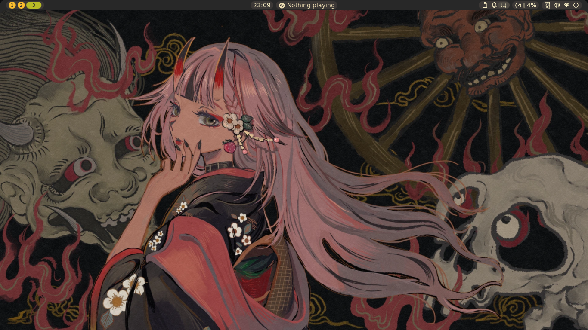
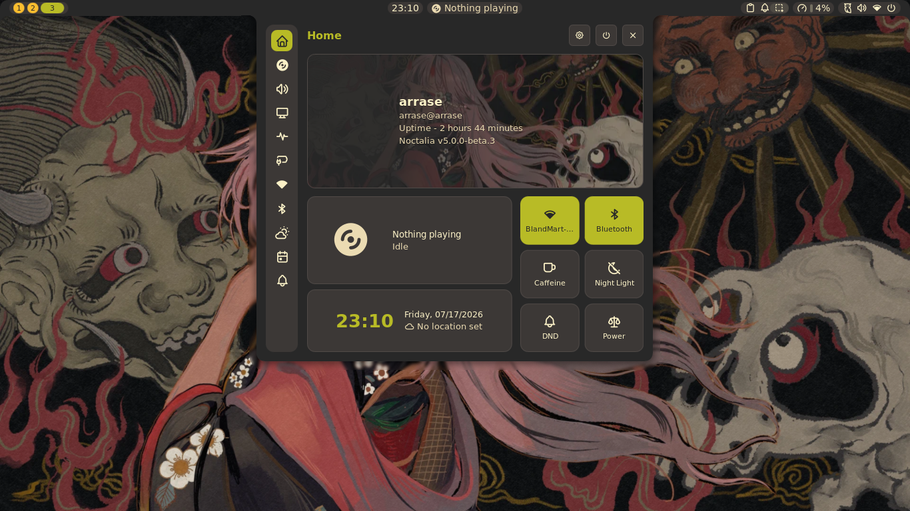
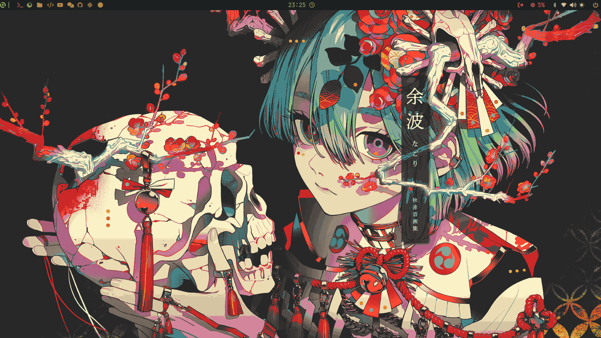
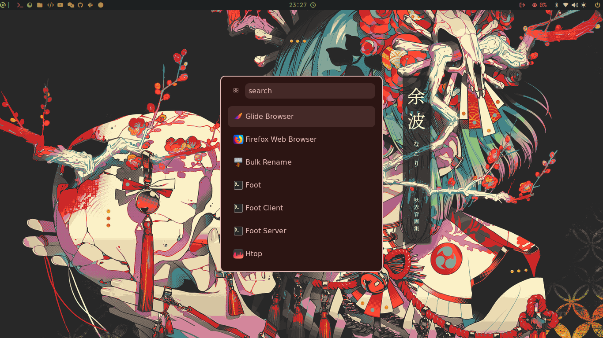
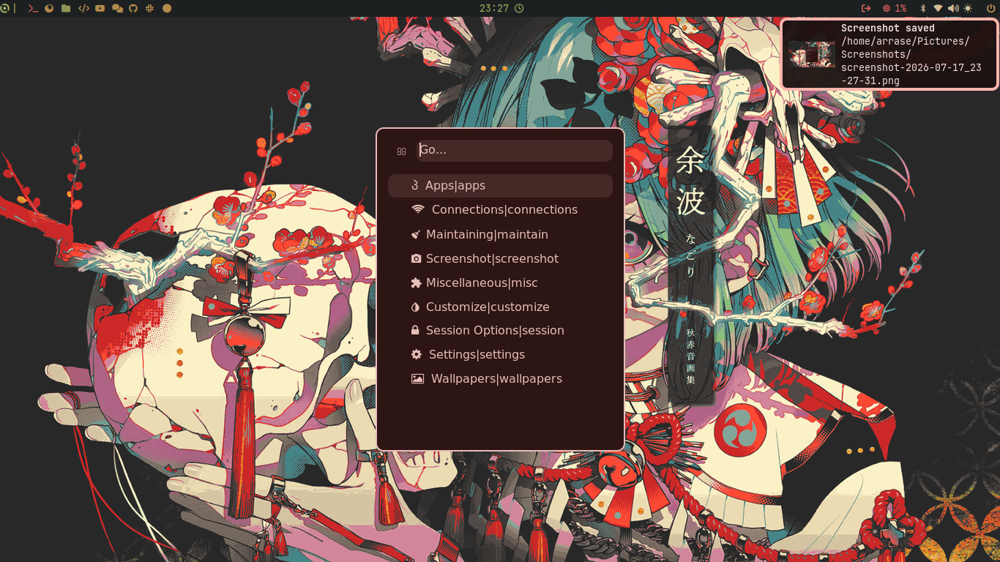

<div align="center">

# 🖥️ My mangowc Setup


A minimal setup for **Void Linux** using Mangowc 🧊  
Includes launchers, notifications, editor  — fully configured!

---
### 🎥 Demo Video


### 🏠 Noctalia



### 🪟 Waybar


### 🧭 Launcher



---

## ⚙️ Installation (only Void Linux)

> 🧩 On other distros, copy `.config` manually to your home folder.

### 📦 Using Curl
```bash
curl -O https://raw.githubusercontent.com/arrase21/void/main/mangowc-install.sh
chmod +x script.sh
sudo ./script
```
---
💚 Made for Void Linux users
with ❤️ by arrase21

💫 Thanks to [DreamMaoMao](https://github.com/DreamMaoMao/mangowc)  
for their amazing work on **mangowc**!

---

## 🐚 Noctalia Shell / Waybar

This setup includes two bar options: **Waybar** (default) and **Noctalia Shell**.

- **Noctalia Shell**: [https://github.com/noctalia-dev/noctalia](https://github.com/noctalia-dev/noctalia)
- **Waybar**: Default configuration included

### 🔄 Switching between bars

To use **Noctalia** instead of Waybar:
1. Open `autostart.sh` and comment **ALL lines** (noctalia handles notifications, clipboard, etc. — leaving them causes duplicates with mako/cliphist) OR Comment `exec-once=~/.config/mango/autostart.sh` in `config.conf`
2. Uncomment `exec-once=noctalia` in `config.conf`
3. Add binds Noctalia

To switch back to **Waybar**:
1. Uncomment all lines in `autostart.sh`
2. Uncomment `exec-once=~/.config/mango/autostart.sh` in `config.conf`
3. Comment `exec-once=noctalia` in `config.conf`
---

## ⚠️ Errors / Workflow Notes

> This is my workflow. There might be errors, so please investigate any issues and fix them.  
> The package names may change from time to time, so check if there's anything wrong with the script.  
> I’ll try to keep it updated whenever I can.

</div>
